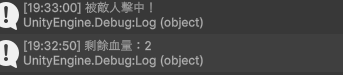
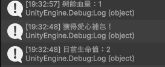

# 第3次練習題目-隨堂-QZ3

> 學號：113111114
>
> 姓名：黃品綾
>
> 作業撰寫時間：180 mins
>
> 最後撰寫文件日期：2026/11/26
>

本份文件包含以下主題：

說明內容

其他（心得）

## 說明內容

1.

Ans:

使用 OnTriggerEnter() 偵測兔子是否碰到敵人，當碰到 Tag 為 Enemy 的物件時，生命值就會減少 1，並顯示剩餘血量。如果生命值變成 0，就會顯示遊戲結束。

if (collision.gameObject.CompareTag("Enemy"))
{
    health -= 1;
    Debug.Log("剩餘血量：" + health);

    if (health <= 0)
    {
        health = 0;
        Debug.Log("遊戲結束！");
    }
}

補包的設定跟敵人類似，只需要將 Tag 改成 Medkit，碰到補包時生命值就會增加 1。為了避免血量超過 3，還需要增加最大生命值的判斷，最後將補包移除。

if (collision.gameObject.CompareTag("Medkit"))
{
    health += 1;

    if (health > maxHealth)
    {
        health = maxHealth;
    }

    Debug.Log("目前生命值：" + health);
    Destroy(collision.gameObject);
}

## 其他

心得：這次練習了學習到如何使用碰撞偵測來控制生命值，碰到敵人會扣血，碰到補包則可以回血，也了解如何限制最大生命值。